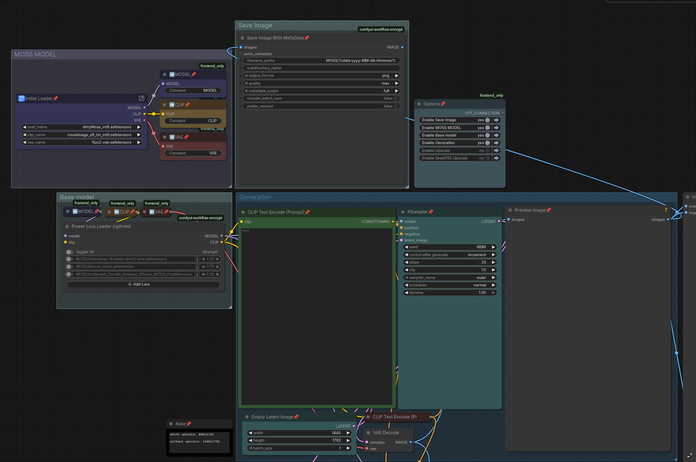
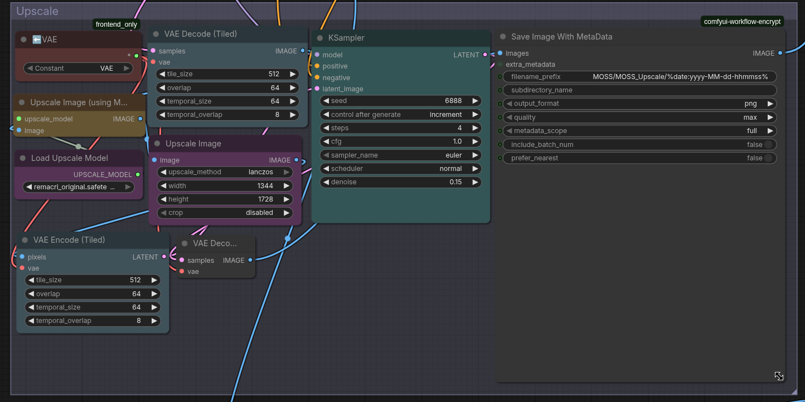
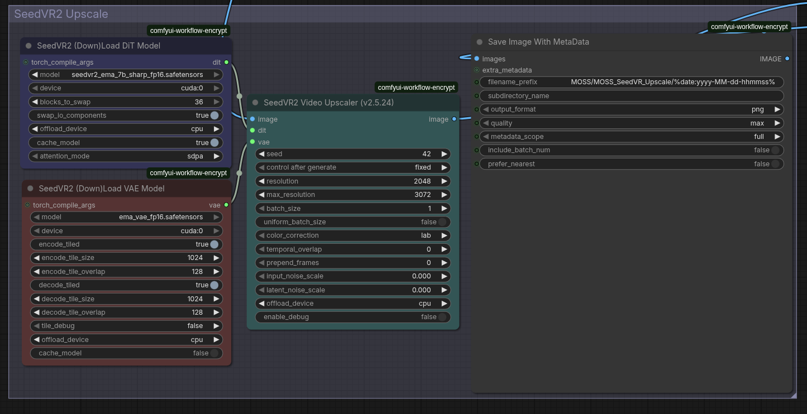

# MOSS-Image — ComfyUI Workflow

A ComfyUI workflow for MOSS-Image text-to-image generation, with a shared LoRA loader, optional upscaling and refinement, and an image comparison view.

**Workflow:** [MOSS_v2.json](MOSS_v2.json)

## Features

- Native component loading through an embedded **Initial Loader** subgraph.
- A shared **Power LoRA Loader** for generation and refinement.
- Optional model-based image upscaling followed by Lanczos resizing and refinement.
- Tiled VAE processing in the main upscale branch.
- A separate, optional **SeedVR2 Upscale** branch.
- An **Image Comparer** for base and refined outputs.
- An **Options** panel for enabling and muting workflow groups.
- PNG saving with workflow metadata and separate output folders.

## Workflow structure

### Model loading and generation

The **MOSS MODEL** group contains the **Initial Loader** subgraph, which exposes diffusion-model, text-encoder, and VAE selectors. Its outputs are shared through Easy-Use Set/Get nodes.

The **Base model** group contains the Power LoRA Loader. The **Generation** group contains the prompt encoders, latent image input, sampler, decoder, and base preview.

The same LoRA-patched diffusion model and positive and negative conditioning feed both generation and the main refinement branch. There is one shared LoRA loader.

### Main upscale and refinement

The **Upscale** group receives the base sampler's latent output:

```text
Base latent → tiled VAE decode → upscale model
            → Lanczos resize → tiled VAE encode
            → MOSS-Image refinement → VAE decode → save
```

The resize node uses fixed width and height rather than a relative scale factor. Changing the generation dimensions does not automatically update its target dimensions.

The **Image Comparer** receives the base preview as **A** and the refined output as **B**.

### SeedVR2 branch

The **SeedVR2 Upscale** group receives the base decoded image independently of the main refinement branch. It has its own DiT and VAE loaders, upscaler, and save node.

The official project is [SeedVR / SeedVR2](https://github.com/ByteDance-Seed/SeedVR). The workflow uses the separate [ComfyUI integration by numz](https://github.com/numz/ComfyUI-SeedVR2_VideoUpscaler).

A **FastFilmGrain** node is connected after SeedVR2 and is bypassed in the export. The Image Comparer is connected to the main refinement output, not to SeedVR2.

## Dependencies

Use [ComfyUI](https://github.com/Comfy-Org/ComfyUI) with native MOSS-Image support and frontend subgraph support. The workflow uses standard component loaders, including `CLIPLoader` with type `moss_image`; it does not use GGUF loaders or an HF-directory loader.

The UUID-like loader node is defined inside the JSON as the **Initial Loader** subgraph; it is not a separate custom-node package.

### Custom nodes

| Package | Nodes used | Role |
| --- | --- | --- |
| [rgthree-comfy](https://github.com/rgthree/rgthree-comfy) | Power LoRA Loader, Fast Groups Muter, Image Comparer | LoRA routing, group controls, comparison |
| [ComfyUI-Easy-Use](https://github.com/yolain/ComfyUI-Easy-Use) | `easy setNode`, `easy getNode` | Shared MODEL, CLIP, and VAE routing |
| [Santodan's revived metadata extension](https://github.com/Santodan/revived_comfyui_image_metadata_extension) | `SaveImageWithMetaData` | Image saving and metadata |
| [SeedVR2 ComfyUI integration](https://github.com/numz/ComfyUI-SeedVR2_VideoUpscaler) | SeedVR2 model loaders and upscaler | Optional SeedVR2 branch |
| [VRGDG provider recorded in the export](https://github.com/vrgamegirl19/comfyui-vrgamedevgirl) | `FastFilmGrain` | Bypassed processing after SeedVR2 |

SeedVR2 and FastFilmGrain do not process images on the saved base path, but their node definitions may still be needed to load the complete canvas without missing-node placeholders. VRGDG utilities are also published in [VRGDG Custom Node Pack](https://github.com/vrgamegirl19/VRGDG_CustomNodePack).

The metadata extension's README links to a maintained fork; the table identifies the provider recorded in the export. Compatibility with replacement providers has not been tested here.

Some saved registry identifiers do not match the actual node names. Resolve dependencies using the node types and linked providers rather than the registry identifiers alone.

### Model files

Model weights are not included. The workflow requires diffusion-model, text-encoder, and VAE components; the optional branches use their own upscale models. LoRAs are optional.

| Component | Standard ComfyUI folder |
| --- | --- |
| Diffusion model | `models/diffusion_models/` |
| Text encoder | `models/text_encoders/` |
| VAE | `models/vae/` |
| LoRAs | `models/loras/` |
| Main upscale model | `models/upscale_models/` |

Existing external model-path configurations can also be used. Saved filenames are local selections, not files distributed by this repository.

## Import and controls

1. Install the custom-node dependencies through ComfyUI-Manager where available, or follow the linked providers' installation instructions. Restart ComfyUI afterward.
2. Download [MOSS_v2.json](MOSS_v2.json) and drag it onto the canvas, or open it through the workflow menu.
3. Resolve any missing node definitions and assign your installed files in the loader nodes.
4. Use the prompt fields in **Generation** and the group switches in **Options** to operate the workflow.

### Saved state

Both upscale groups are muted, all LoRA rows are disabled, and FastFilmGrain is bypassed. The Image Comparer remains enabled with an empty saved image list.

### Output paths

- **Base only:** keep **MOSS MODEL**, **Base model**, **Generation**, and **Save Image** active. Keep both upscale groups muted and mute the standalone Image Comparer, whose second input comes from the refinement branch.
- **Main refinement:** enable **Upscale** and the Image Comparer. This produces the base image and the main refined output.
- **SeedVR2:** enable **SeedVR2 Upscale**. This branch processes the base image independently. The main refinement branch can remain muted; mute the comparer when the main refinement branch is unused.

The main refinement and SeedVR2 branches can also be enabled together. Both receive data from base generation; neither branch feeds the other.

### Saved images

PNG outputs use timestamp-based names and full workflow metadata. Paths are relative to ComfyUI's configured output folder.

| Output | Folder |
| --- | --- |
| Base | `MOSS/` |
| Main refined output | `MOSS/MOSS_Upscale/` |
| SeedVR2 output | `MOSS/MOSS_SeedVR_Upscale/` |

## Workflow screenshots

### Model loading and generation



### Main upscale and refinement



### SeedVR2 branch



The screenshots show the workflow interface. Values visible in the controls belong to the captured session.

## Third-party components and verification

The workflow and documentation are released under the [MIT License](LICENSE), copyright © 2026 NymZero.

Model weights and custom nodes remain subject to their publishers' licenses.

The documentation was checked against the JSON's nodes, connections, subgraph, and saved branch states. The supplied JSON and screenshots are preserved unchanged. No ComfyUI generation or GPU test was performed during documentation preparation.
